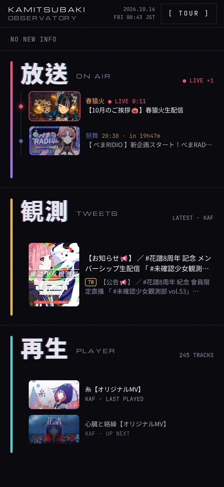
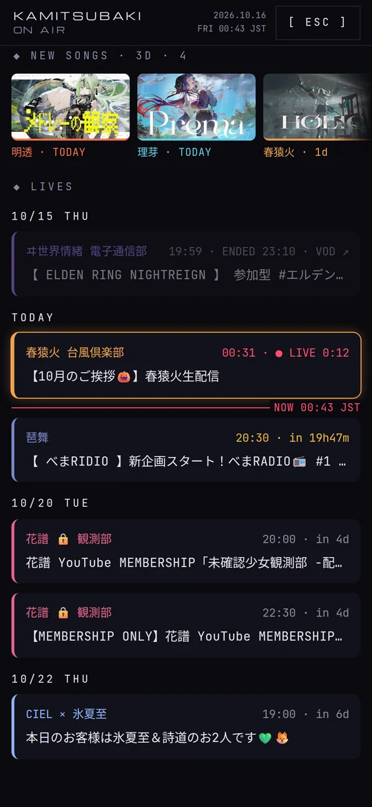
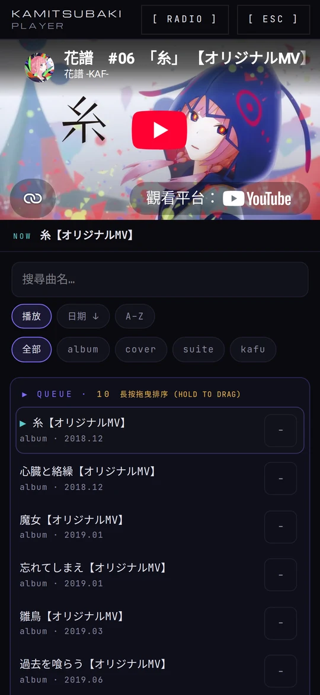

🌐 個人網站：**[cholate.dev](https://cholate.dev)**

[English](README.md) | **繁體中文**

## 🎯 我的專案集

哈囉 👋 這個 repo 基本上就是我所有專案的 **集散地**。請慢慢逛 ~

---

## ⭐ 精選：KAF Observatory

為虛擬歌手 **KAF（花譜）** 打造的 3D 聆聽室。

- 🖥️ **桌機版**：牆上的螢幕播放 MV，檯燈和時鐘跟著音樂脈動。
- 📱 **手機版**：直播行程表，以及收錄 245 首歌的播放器。

  &nbsp;
  &nbsp;
  

---

## 🤖 機器人 / 工具
| 專案 | 用途 | 時間 |
|---------|--------------|------|
| [KAF&nbsp;Posts&nbsp;Ingest](https://github.com/cholateio/kaf-posts-ingest) | 每小時執行的 worker，抓取 KAF 相關的 X 貼文、從日文翻成繁體中文，並找出直播。 | 2026&nbsp;年&nbsp;4&nbsp;月 |
| [Song&nbsp;Analysis](https://github.com/cholateio/song-analysis) | YouTube 擷取 + 音訊分析流程：產出逐影格的頻譜資料，供 3D 視覺化使用。 | 2026&nbsp;年&nbsp;4&nbsp;月 |
| [Sekai&nbsp;Border](https://github.com/cholateio/sekai-border) | 每 5 分鐘爬取 Project Sekai 的活動排名（前 100 名與各檔線）。 | 2026&nbsp;年&nbsp;3&nbsp;月 |
| [YT&nbsp;Summary](https://github.com/cholateio/yt-summary) | 把 YouTube 影片整理成繁體中文的重點文章，存進我的知識庫。 | 2026&nbsp;年&nbsp;7&nbsp;月 |
| [RepoBox](https://github.com/cholateio/repobox) | 從手機的分享選單收藏 GitHub repo，由你自己的 Claude 訂閱幫每個專案寫一段白話介紹和一張架構圖。 | 2026&nbsp;年&nbsp;10&nbsp;月 |
| [Arch&nbsp;Blueprint](https://github.com/cholateio/arch-blueprint) | 一個 agent skill，為任何 repo 畫出一頁藍圖風格的架構圖，並用腳本檢查。 | 2026&nbsp;年&nbsp;10&nbsp;月 |

---

## 🌐 網站
| 專案 | 用途 | 時間 |
|---------|--------------|------|
| [Life&nbsp;Tracker](https://github.com/cholateio/life-tracker) | 全端、行動優先的個人紀錄系統 | 2026&nbsp;年&nbsp;3&nbsp;月 |
| [Portfolio](https://cholate.dev) | 我的個人作品集網站。 | 2025&nbsp;年&nbsp;12&nbsp;月 |
| [Blog](https://blog.cholate.dev) | 極簡的繁體中文技術部落格。 | 2026&nbsp;年&nbsp;7&nbsp;月 |
| [Sekai&nbsp;Archive](https://sekai-archive.vercel.app) | 結合 LLM agent 與 RAG 的 Project Sekai 活動攻略助手。 | 2026&nbsp;年&nbsp;3&nbsp;月 |
| [Casepick](https://casepick.pages.dev) | 自動從 X 收集「大家用 AI 做出了什麼」的訊號站，去除重複並提供雙語內容。 | 2026&nbsp;年&nbsp;7&nbsp;月 |
| [Eureka](https://eureka-2l0.pages.dev) | 實分析的中文對照閱讀器，共 45 節的定義、定理與證明。 | 2026&nbsp;年&nbsp;7&nbsp;月 |

---

## 📺 串流 / 媒體
| 專案 | 用途 | 時間 |
|---------|--------------|------|
| [KAF&nbsp;Observatory](https://kaf-observatory.vercel.app) | ↑ 見上方精選。 | 2026&nbsp;年&nbsp;4&nbsp;月 |
| [LiveRiver](https://live-river.vercel.app) | 貼上任何 YouTube 或 Twitch 頻道，就能在同一條時間軸上，用你的時區看它們什麼時候開播。 | 2026&nbsp;年&nbsp;10&nbsp;月 |
| [Swarm&nbsp;Clock](https://github.com/cholateio/swarm-clock) | 隨音樂做出視覺反應的粒子群時鐘。 | 2026&nbsp;年&nbsp;3&nbsp;月 |
| [Virtual&nbsp;Music&nbsp;Clock](https://github.com/cholateio/virtual-music-clock) | 隨音樂做出視覺反應的桌面時鐘。 | 2026&nbsp;年&nbsp;3&nbsp;月 |

---

## 🎨 入門 / 元件
| 專案 | 用途 | 時間 |
|---------|--------------|------|
| [Image&nbsp;Gallery&nbsp;Component](https://github.com/cholateio/image-gallery) | 給 Next.js 用的圖片藝廊元件。 | 2025&nbsp;年&nbsp;10&nbsp;月 |
| [Todo&nbsp;List&nbsp;App](https://github.com/cholateio/todo-list) | 給 Next.js 用的待辦事項元件。 | 2026&nbsp;年&nbsp;3&nbsp;月 |
| [Multi-Agent&nbsp;Starter](https://github.com/cholateio/multi-agent-starter) | Claude Code 工作流程套件：Codex 跨模型審查、審查關卡與重試熔斷機制。 | 2026&nbsp;年&nbsp;3&nbsp;月 |
---
